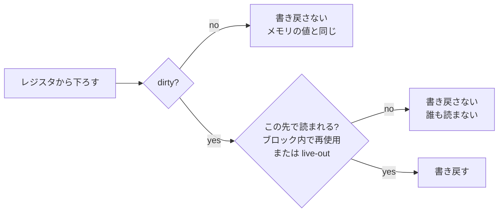
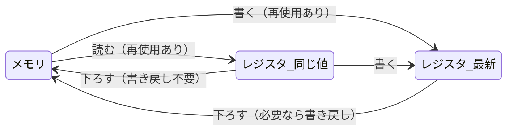
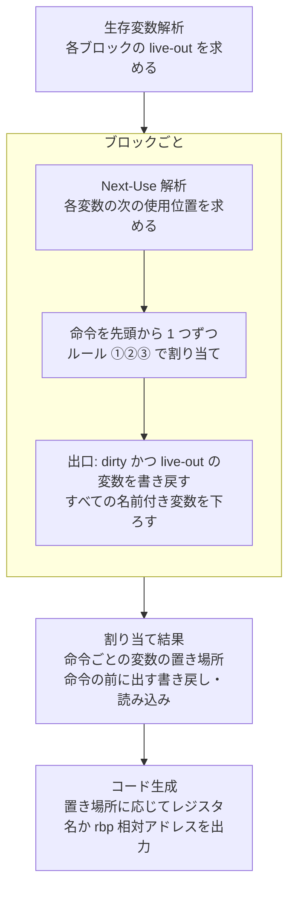

# レジスタ割り当て

## ひとことで

**基本ブロックの中だけ、変数をレジスタに置いて計算する。ブロックを出るときに、必要な変数だけメモリに戻す。**

ドラゴンブック §8.6「単純なコード生成器」と同じ方式。

## 用語

| 用語 | 意味 |
| --- | --- |
| 基本ブロック | 途中に分岐も合流もない命令の並び。`if` や `while` の境目で区切られる |
| Temp | IR が式の途中結果用に作る名前の無い変数（`%3` など）。1 つのブロック内で作られて使い切られる |
| 名前付き変数 | ソースに書いたローカル変数・引数（`%0.a` など）。各自スタック上にスロット（置き場所）を持つ |
| 生存している | その変数の今の値が、この先どこかで読まれる |
| live-out | ブロックの出口で生存している変数の集合。生存変数解析（`LivenessAnalysis`）で求める |
| 次の使用 | ブロック内でその変数が次に読まれる命令の位置。Next-Use 解析（`NextUseAnalysis`）で求める |
| dirty | レジスタ上で書き換えたが、まだメモリに戻していない状態 |

## 例で見る

```c
int main() {
    int a = 1;
    int b = 2;
    int c = (a + b) * (a - b);
    return c;
}
```

変更前は、名前付き変数を使うたびにメモリを読み書きしていた。

```asm
movq $1, %rax
movl %eax, -4(%rbp)        # a をメモリに書く
movq $2, %rax
movl %eax, -8(%rbp)        # b をメモリに書く
movslq -4(%rbp), %r10      # a を読む
movslq -8(%rbp), %rcx      # b を読む
addq %rcx, %r10            # a + b
movslq -4(%rbp), %r11      # また a を読む
movslq -8(%rbp), %rcx      # また b を読む
subq %rcx, %r11            # a - b
imulq %r11, %r10
movl %r10d, -12(%rbp)      # c をメモリに書く
movslq -12(%rbp), %rax     # c を読む
```

今は、ブロック内では `a` と `b` をレジスタに置いたまま使う。`a`・`b`・`c` はどれも `return` の後では使われない（live-out でない）ので、メモリには一度も書かない。

```asm
movq %rbx, -8(%rbp)        # rbx を使うので退避
movq $1, %r10              # a
movq $2, %r11              # b
movq %r10, %rbx
addl %r11d, %ebx           # a + b（int なので 32bit 演算）
subl %r11d, %r10d          # a - b（a はもう使わないので r10 を上書き）
imull %r10d, %ebx          # c
movq %rbx, %rax
movq -8(%rbp), %rbx        # rbx を復元
```

変数用のメモリアクセスは 8 回から 0 回に減る。代わりに、r10・r11 が埋まって callee-saved の rbx を使うため、その退避と復元が 2 回入る。

## 3 つのルール

割り当ては、命令を先頭から 1 つずつ見ながら、次の 3 つを判断するだけ。

### ① いつレジスタに載せるか

**ブロック内でもう一度使うときだけ** 載せる。一度しか使わない変数は、メモリを直接読み書きする方が速い。

| 場面 | 再使用あり | 再使用なし |
| --- | --- | --- |
| 変数を読む | メモリからレジスタに読み込む（Reload） | メモリを直接読む |
| 変数に書く | レジスタに書く（dirty になる） | メモリに直接書く |

Temp はスロットを持たないので、常にレジスタに載せる。

### ② いつレジスタから下ろすか

- **もう使わないとき**: そのレジスタを空ける
- **レジスタが足りないとき**: 次に使うのが一番先の変数を追い出す
- **関数呼び出し（Call）の直前**: r10・r11 は呼び出し先で壊されるので、そこにある名前付き変数を下ろす
- **ブロックの出口**: すべての名前付き変数を下ろす

### ③ 下ろすときにメモリへ書き戻すか

**dirty で、かつこの先で値が読まれるときだけ** 書き戻す。



「この先で読まれるか」をブロックの外まで含めて判断できるのは、生存変数解析の live-out があるため。

## 変数の状態

名前付き変数はブロック内で 3 つの状態を行き来する。ブロックの入口では必ず「メモリ」から始まる。



| 状態 | レジスタ | メモリ |
| --- | --- | --- |
| メモリ | 無い | 最新 |
| レジスタ（同じ値） | 最新 | 最新 |
| レジスタ（最新）= dirty | 最新 | 古い |

## 使うレジスタ

| 種類 | レジスタ | 特徴 |
| --- | --- | --- |
| caller-saved | r10, r11 | 自由に使えるが、Call で壊される |
| callee-saved | rbx, r12〜r15 | Call を跨いでも保たれる。使った分は関数の入口で退避し、出口で復元する |

rax・rcx・rdx・引数レジスタ（rdi など）は使わない。除算（`idivq` が rax と rdx を使う）や関数呼び出し（戻り値が rax に入る、引数を rdi などに置く）で決まったレジスタを使う命令があり、そこと衝突しないようにするため。

Call を跨いで生き続ける Temp には、最初から callee-saved を割り当てる。

## 注意が必要なケース

### 引数（Param）は Call まで解放しない

`g(a, b)` は IR では次のようになる。

```
Param a
Param b
Call  g
```

コード生成は Call の時点でまとめて引数を並べる。このとき、各引数は **Param 時点で置かれていたレジスタ** から読む。

もし `Param a` で a のレジスタ（r10）を空けると、`Param b` で b が r10 に読み込まれ、Call で a のつもりで r10 を読むと b の値になってしまう。そのため Param で使い終わった変数は、Call まで解放しない。

### 演算は型の幅で行う

演算命令のサフィックスとレジスタ名を、型の幅に合わせる。

| 型 | 演算 | 例 |
| --- | --- | --- |
| `long` | 64bit（`q`） | `addq %r11, %rbx` / `cqto` + `idivq` |
| `int` | 32bit（`l`） | `addl %r11d, %ebx` / `cltd` + `idivl` |
| `char`・`bool` | 32bit（`l`）。C の整数昇格と同じく、読み込み時に `movsbl` で 32bit に広げる | `cmpl $0, %r10d` |

レジスタ上の値は「型の演算幅の下位ビットだけが有効」として扱う。`int` を 64bit で計算すると、オーバーフロー時に 32bit で折り返さず、メモリに書いた場合と値が変わってしまう。32bit 命令で計算すれば自然に折り返し、さらに x86-64 では 32bit レジスタへの書き込みで上位 32bit が 0 になるため、上位にゴミも残らない。

### 同じ命令で読み書きする変数

`x = x + 1` のように 1 命令で同じ変数を読んで書く場合、読みと書きで同じレジスタを使う。1 命令の中で変数の置き場所は 1 つだけ、という前提をコード生成が持っているため。

## 処理の流れ



## ソースとの対応

| ファイル | 役割 |
| --- | --- |
| `src/Common/Ir/LivenessAnalysis.cs` | live-out を求める |
| `src/Backend/NextUseAnalysis.cs` | ブロック内での次の使用位置を求める。出口の初期状態に live-out を使う |
| `src/Backend/RegisterAllocator.cs` | ルール ①②③ による割り当て |
| `src/Backend/Type/Allocation.cs` | 割り当て結果の型 |
| `src/Backend/CodeGenerator.cs` | 命令の前に書き戻し（`SpillsBefore`）と読み込み（`ReloadsBefore`）を出力する |
| `src/Backend/OperandEmitter.cs` | 変数をレジスタ名または `offset(%rbp)` として出力する |

`RegisterAllocator` の主な状態:

| フィールド | 内容 |
| --- | --- |
| `registerTable` | 各レジスタに今どの変数が載っているか |
| `locationTable` | 各変数が今どこにあるか（レジスタ / スタック） |
| `dirtyVariables` | dirty な名前付き変数 |
| `pendingArguments` | Param で使い終わったが、Call まで解放を待っている変数 |

`RegisterAllocator` の主なメソッド:

| メソッド | 内容 |
| --- | --- |
| `AllocateInstruction` | 1 命令分の割り当て。使用する変数の配置 → 不要になったレジスタの解放 → 定義先の配置の順に行う |
| `LoadNamed` | ルール ①: 読む変数をレジスタに載せるか決める |
| `Assign` | 定義先のレジスタを決める。空きが無ければ追い出す |
| `IsReleasable` | ルール ②: もう下ろしてよいか |
| `IsNeededInMemory` | ルール ③: 下ろすときに書き戻しが要るか |
| `SpillCallerSaved` | Call の直前に r10・r11 上の名前付き変数を下ろす |

## 今の限界

| 限界 | 影響 | 次の手 |
| --- | --- | --- |
| ブロックを跨いでレジスタに置けない | `for` のように条件・本体・更新が別ブロックのループでは、ブロックを移るたびにメモリを経由するため効果が小さい | グラフ彩色で関数全体を割り当てる |
| 使えるレジスタが 7 本だけ | 変数が多いとすぐ追い出しが起きる | 除算・Call で使うレジスタも、その命令を跨がない変数には割り当てる |
| 再使用する変数を演算すると `mov` が増えることがある | x86 の演算は片方のオペランドを結果で上書きするため、元の値を残すコピーが要る | コピーを減らす最適化（コアレッシング） |
