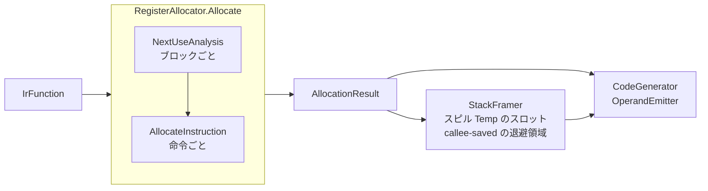
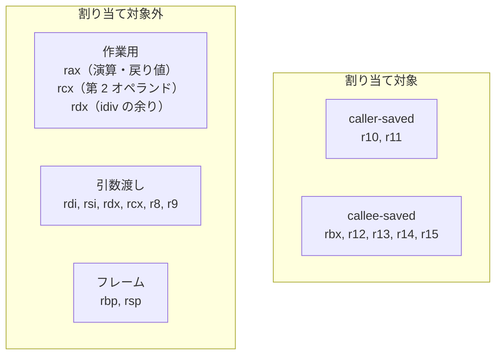
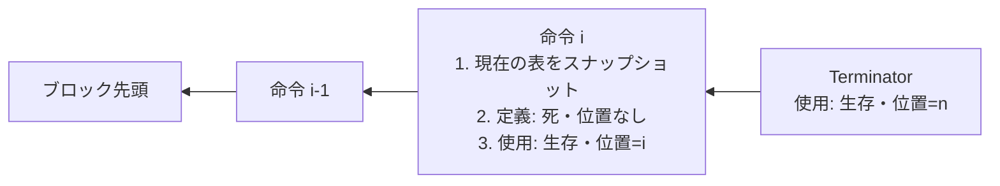
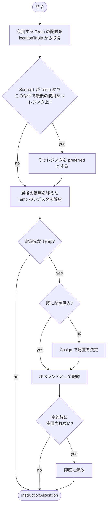
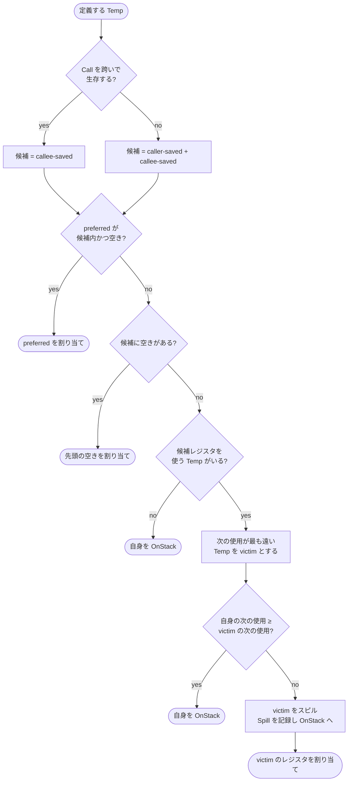
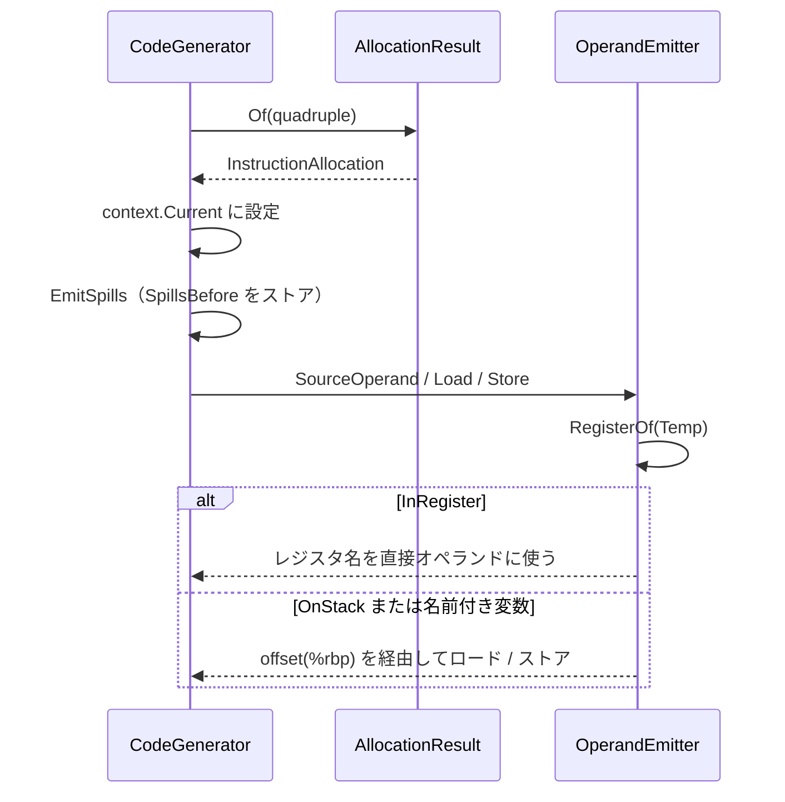

# レジスタ割り当て

現状のレジスタ割り当ての手法と実装をまとめる。

## 概要

- **対象**: 一時変数（`Variable.IsTemporary`、名前を持たない Temp）のみ
  - ローカル変数・引数は常にスタックフレーム上（`rbp` 相対）に置き、使用のたびにロード / ストアする
- **単位**: 基本ブロック単位の局所的な割り当て
  - Temp は 1 つの基本ブロック内で生成・消費される前提（ブロックを跨ぐと例外）
- **手法**: Next-Use 情報に基づく貪欲な割り当て（ドラゴンブック §8.6 の `getReg` に相当）
  - 命令を先頭から順に処理し、定義された Temp に空きレジスタを割り当てる
  - 最後の使用を終えた Temp のレジスタは即座に解放する
  - 空きが無ければ、次の使用が最も遠い Temp をスタックへ追い出す（Belady 方式）

## パイプライン上の位置



| ファイル | 役割 |
| --- | --- |
| `src/Backend/NextUseAnalysis.cs` | ブロック内の各命令時点での生存・次の使用位置を求める |
| `src/Backend/RegisterAllocator.cs` | Temp ごとの配置（レジスタ / スタック）を命令単位で決定する |
| `src/Backend/Type/Allocation.cs` | 割り当て結果の型（`Location` / `Spill` / `InstructionAllocation` / `AllocationResult`） |
| `src/Backend/StackFramer.cs` | スピルした Temp と使用した callee-saved レジスタをスタックフレームに配置する |
| `src/Backend/OperandEmitter.cs` | 割り当て結果を参照し、オペランドをレジスタ名または `rbp` 相対アドレスとして出力する |

## 割り当て対象のレジスタ



- `RegisterGroup.CallerSavedAllocatableRegisters()` / `CalleeSavedAllocatableRegisters()` で定義
- caller-saved は `call` で破壊されるため、Call を跨いで生存する Temp には使わない
- callee-saved は使用した分だけ関数のプロローグで退避し、エピローグで復元する（`StackFrame.SavedRegisters`）

## Next-Use 解析

`NextUseAnalysis.Analyze(block)` はブロックの末尾から先頭へ命令を逆向きにたどり、各命令の各オペランドについて以下を記録する。

- `IsLive`: その命令の後で生存しているか
- `Position`: 次に使用される命令位置（ブロック内に無ければ `null`）

初期状態（ブロック出口）は「名前付き変数は生存、Temp は死」とする。名前付き変数はブロックを跨ぎうるが、ブロック内解析では判断できないため保守的に生存とみなしている。



同じ命令で使用と定義を兼ねる変数（`x = x + 1`）は、定義で「死」にしてから使用で「生存」に上書きするため、命令の直前では正しく生存となる。

解析結果 `BlockNextUse` は以下を提供する。

| メソッド | 内容 |
| --- | --- |
| `Of(quadruple).Of(variable)` | 命令時点でのオペランドの `NextUse` |
| `OfTerminator()` | Terminator 時点での `NextUse` |
| `LastUse(variable)` | ブロック内での最後の使用位置 |
| `NextUseAfter(variable, position)` | `position` より後の最初の使用位置 |

## 命令ごとの割り当て

`RegisterAllocator` は以下の状態を関数全体で保持する。

| フィールド | 内容 |
| --- | --- |
| `registerTable` | レジスタ → 現在そこに載っている Temp（レジスタ記述子） |
| `locationTable` | Temp → 配置場所 `InRegister(reg)` / `OnStack`（アドレス記述子） |
| `usedRegisters` | 一度でも使ったレジスタ（callee-saved の退避対象決定に使う） |
| `spilledTemps` | スタックに置かれた Temp（スタックフレームにスロットを確保する） |

`AllocateInstruction` の処理順は以下のとおり。



使用 Temp の解放を定義先の割り当てより先に行うことで、`t3 = t1 + t2` のように最後の使用を終えた `t1` のレジスタを `t3` が再利用できる。`preferred` はこの再利用を優先させるためのもので、x86 の 2 オペランド形式（`addq src, dst`）で `Source1` と同じレジスタに結果を置けば `mov` を 1 つ省ける。

### Assign: 配置場所の決定



- **Call を跨ぐ判定**: 定義位置から `LastUse` までの間に `Call` 命令があるか
- **victim の選択**: 現在レジスタにある Temp のうち `NextUseAfter` が最も遠いもの。自身の方が遠い場合は自身をスタックに置く
- **スピル**: `Spill(victim, register)` を命令の `SpillsBefore` に記録し、コード生成時に命令の直前で `mov reg, offset(%rbp)` を出力する。以降 victim は `OnStack` として扱う

## コード生成での利用



- 演算の出力先が Temp でレジスタに割り当てられていれば、そのレジスタ上で直接演算する
- そうでなければ `rax` で演算し、結果を `Store` で書き戻す
- `Param` は `PendingArguments` に命令時点の `InstructionAllocation` ごと積み、`Call` で引数レジスタへ配置する（Param 時点の配置を参照するため）

## 例

```c
int f(int x) { return x; }
int main() { int a = 1; int b = 2; int c = (a + b) * (a - b) + f(a); return c; }
```

```
(Assign,   %0.a, 1:I32, _)
(Assign,   %1.b, 2:I32, _)
(Add,      %3,   %0.a,  %1.b)    %3 -> r10
(Subtract, %4,   %0.a,  %1.b)    %4 -> r11
(Multiply, %5,   %3,    %4)      %5 -> rbx（Call を跨ぐため callee-saved）、%3 %4 は解放
(Param,    _,    %0.a,  _)
(Call,     %6,   @f,    _)       %6 -> r10
(Add,      %7,   %5,    %6)      %7 -> rbx（preferred: %5 のレジスタを再利用）
(Assign,   %2.c, %7,    _)
return %2.c
```

```asm
main:
	pushq %rbp
	movq %rsp, %rbp
	subq $32, %rsp
	movq %rbx, -8(%rbp)       # 使用した callee-saved を退避
	movq $1, %rax
	movl %eax, -12(%rbp)      # a（名前付き変数はスタック）
	movq $2, %rax
	movl %eax, -16(%rbp)      # b
	movslq -12(%rbp), %r10
	movslq -16(%rbp), %rcx
	addq %rcx, %r10           # %3 = a + b
	movslq -12(%rbp), %r11
	movslq -16(%rbp), %rcx
	subq %rcx, %r11           # %4 = a - b
	movq %r10, %rbx
	imulq %r11, %rbx          # %5 = %3 * %4
	movslq -12(%rbp), %rdi
	movl $0, %eax
	call f
	movq %rax, %r10           # %6
	addq %r10, %rbx           # %7 = %5 + %6
	movl %ebx, -20(%rbp)      # c
	movslq -20(%rbp), %rax
	movq -8(%rbp), %rbx       # callee-saved を復元
	movq %rbp, %rsp
	popq %rbp
	ret
```

## 制約と今後

| 現状の制約 | 影響 | 改善案 |
| --- | --- | --- |
| 名前付き変数（ローカル・引数）はレジスタに載らない | ループ変数なども毎回メモリを読み書きする（例の `a` は 3 回ロード） | 生存変数解析（`LivenessAnalysis`）に基づくグラフ彩色で関数全体を割り当てる |
| 割り当てがブロック単位 | ブロックを跨ぐ値はメモリ経由になる | 同上 |
| caller-saved が `r10` / `r11` の 2 本のみ | 引数レジスタ・作業用レジスタを割り当てに使えない | 作業用レジスタの使用を減らし、引数レジスタを Call 間で割り当て可能にする |
| スピル先のスロットは Temp ごとに固定 | 生存範囲が重ならない Temp 同士でもスロットを共有しない | スタックスロットの彩色 |
