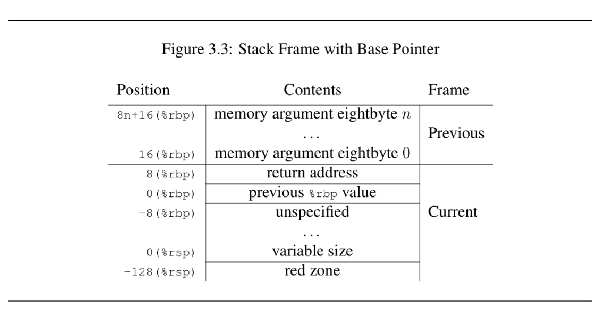

# Stack Frame の設計

1つの関数が持つ Stack Frame 上にどのような情報をどのようなレイアウトで持つかを設計する


```
# 関数の引数
Parameters
---
# 返り値
Returned Value
---
# 呼び出し元関数の fp
Control Link
---
# Return Address
# 今は無いが、 Register 情報
Saved Machine State
---
# local 変数
Local Variables
---
# 一時変数
Temporary Variables
```

他のライブラリを呼びたいので以下に合わせる


